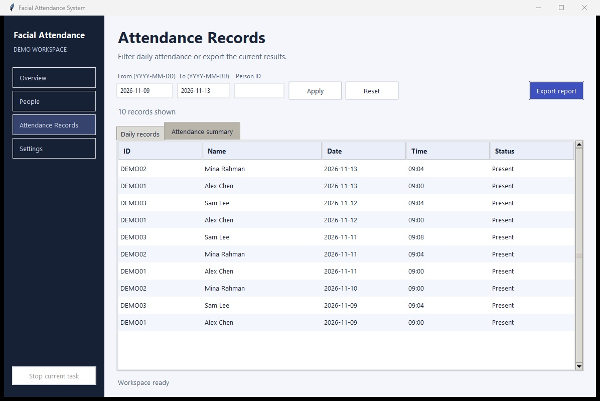
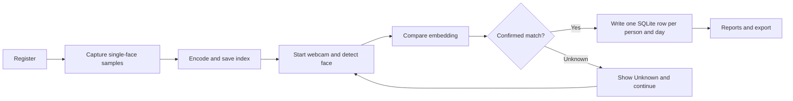

# Facial Attendance System

A Python desktop attendance project originally completed for my fourth-semester Object Oriented Techniques course at Zhengzhou University. The coursework prototype used Tkinter, a webcam and dlib face encodings. The portfolio version adds SQLite storage, CSV and Excel reports, and an OpenCV recognition option. The redesigned desktop workspace guides an operator from enrollment to attendance and reporting.

[](https://devbyabir.github.io/facial-attendance-system/)

The browser demo uses fictional records and simulated scans to show daily attendance, duplicate handling, filters and CSV export. For webcam recognition, run the Python desktop app.


## Set up on Windows

Use 64-bit Python 3.10 or newer with Tcl/Tk. In PowerShell, run:

```powershell
python -m venv .venv
.\.venv\Scripts\python.exe -m pip install -r requirements.txt
.\.venv\Scripts\python.exe main.py --demo
```

Demo mode opens a temporary database with three fictional people and five days of attendance. Use **People** to view the roster or **Attendance Records** to filter and export records without a webcam or model download.

For the live workflow, close the Windows Camera app and run:

```powershell
.\.venv\Scripts\python.exe check_camera.py --preview
.\.venv\Scripts\python.exe download_models.py
.\.venv\Scripts\python.exe main.py
```

The preview exits with Q or Esc. Try `--camera 1` if you have a second webcam. The model downloader verifies the two official OpenCV Zoo files against pinned SHA-256 checksums. It downloads model files only.

### Optional dlib backend

For the original recognition approach, install Visual Studio Build Tools with **Desktop development with C++**, MSVC and a Windows SDK. Install CMake and check that `cmake --version` works. In Developer PowerShell for Visual Studio, check that `cl` is available, then run:

```powershell
.\.venv\Scripts\python.exe -m pip install -r requirements-dlib.txt
.\.venv\Scripts\python.exe -c "import dlib, face_recognition; print(dlib.__version__)"
```

A trusted prebuilt wheel must match the Python version and Windows architecture. If dlib cannot build, keep the default OpenCV option. Select a backend before training and use the same one for attendance. Each backend has its own encoding index.

- [face_recognition installation](https://github.com/ageitgey/face_recognition#installation)
- [dlib build instructions](https://github.com/davisking/dlib)
- [Visual Studio Build Tools](https://visualstudio.microsoft.com/downloads/)
- [OpenCV YuNet and SFace](https://docs.opencv.org/4.x/d0/dd4/tutorial_dnn_face.html)

## Use the app

1. Open **Settings** and run **Check camera**. Choose the OpenCV or dlib backend.
2. In **People**, select **Register Person**. Enter a unique ID, name and department. Press Space to capture each of the 24 samples, varying the pose slightly. Only frames with one face count. Press Q or Esc to cancel.
3. In **Settings**, select **Generate encodings**. The status bar reports usable and skipped samples. The People view shows who still needs an encoding.
4. In **Overview**, select **Start Attendance**. Present one person at a time. The preview confirms a match across three processed frames and displays the name, ID and result. To end the run, press Q or Esc in the preview or use **Stop current task**.
5. In **Attendance Records**, apply an inclusive date range and optional person ID. **Export report** exports the applied filter. CSV contains daily records. Excel includes daily records and a summary. The summary divides present days by calendar days in the selected range, including weekends.



## Project design



- `main.py` and `src/gui.py` launch the dashboard. Camera and training jobs run in a worker thread while Tkinter handles display and messages on its main thread.
- `config.py` defines local paths, camera settings and thresholds. `src/register_face.py` stages samples and discards them if registration is cancelled.
- `src/vision.py` supports YuNet detection with SFace embeddings and cosine similarity. The optional dlib backend uses HOG detection, 128-value embeddings and Euclidean distance.
- `src/train_encodings.py` keeps each usable embedding in a NumPy archive. Index replacement is atomic. The loader uses `allow_pickle=False`.
- `src/recognize.py` processes alternate frames. OpenCV uses the full frame because quarter-scale input missed the sample face in testing. The dlib option uses quarter-scale frames. `src/attendance.py` confirms consecutive matches and `src/db_manager.py` enforces unique daily records in SQLite.
- `src/reports.py` filters attendance and exports Excel or CSV. The runtime folders `database/`, `dataset/`, `encodings/`, `models/` and `reports/` stay local.

## Verification and limitations

```powershell
.\.venv\Scripts\python.exe -m unittest discover -s tests -v
```

GitHub Actions runs the camera-free checks on Windows with Python 3.10 and 3.12. The suite covers duplicate enrollment and attendance, filtered reports, CSV/Excel export, unknown-face rejection, consecutive match confirmation, multiple faces during enrollment, missing encodings, empty training data and camera failure. The recognition workflow test uses synthetic embeddings and simulated camera frames.

The Windows Tkinter demo was checked for navigation, filtering, reset and export. The original webcam preview was verified at 640 × 480. A complete live run on the redesigned app still needs a webcam and a consenting participant. To verify it, enroll one person, generate encodings, mark attendance, try a second scan on the same day, and export the resulting single row. Also try a second face in frame and reduced lighting. No population accuracy figure has been measured.

Only fictional data appears in the screenshots. Local face samples, encoding indexes, databases, reports and downloaded models are excluded by `.gitignore`.

For a small evaluation, use consented samples distinct from the enrollment images. Test known and unknown people across lighting conditions and record false accepts and false rejects separately. Increasing the SFace similarity threshold or decreasing dlib distance tolerance makes matching stricter. This prototype does not check liveness, so a photo may be accepted. An attendance calendar and liveness checks are future work.
