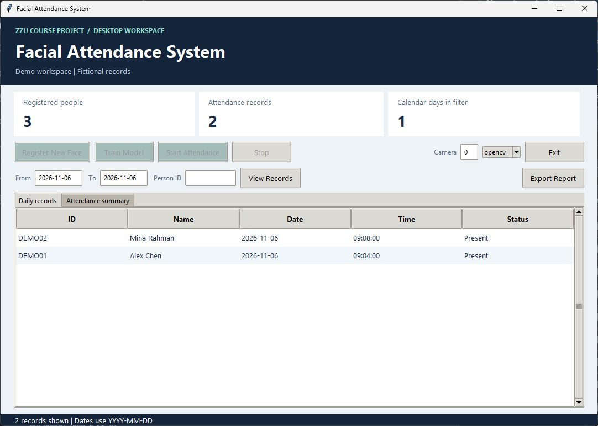
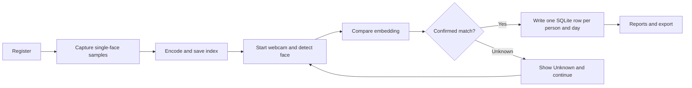

# Facial Attendance System

A Python desktop attendance project originally completed for my fourth-semester Object Oriented Techniques course at Zhengzhou University. The coursework prototype used Tkinter, a webcam and dlib face encodings. This portfolio refresh adds SQLite, filtered reports, a redesigned dashboard and an OpenCV recognition option.



## Set up on Windows

Use 64-bit Python 3.10 or newer with Tcl/Tk. In PowerShell, run:

```powershell
python -m venv .venv
.\.venv\Scripts\python.exe -m pip install -r requirements.txt
.\.venv\Scripts\python.exe main.py --demo
```

Demo mode uses fictional records in a temporary database. You can filter and export them without a camera or model download.

For the live workflow, close the Windows Camera app and run:

```powershell
.\.venv\Scripts\python.exe check_camera.py --preview
.\.venv\Scripts\python.exe download_models.py
.\.venv\Scripts\python.exe main.py
```

The preview exits with Q or Esc. Try `--camera 1` if you have a second webcam. The model downloader verifies the two official OpenCV Zoo files against pinned SHA-256 checksums. It downloads model files only.

### Optional dlib backend

For the original recognition approach, install Visual Studio Build Tools with **Desktop development with C++**, MSVC and a Windows SDK. Install CMake and check that `cmake --version` works. In Developer PowerShell for Visual Studio, check that `cl` is available, then run:

```powershell
.\.venv\Scripts\python.exe -m pip install -r requirements-dlib.txt
.\.venv\Scripts\python.exe -c "import dlib, face_recognition; print(dlib.__version__)"
```

A trusted prebuilt wheel must match the Python version and Windows architecture. If dlib cannot build, keep the default OpenCV option. Select a backend before training and use the same one for attendance. Each backend has its own encoding index.

- [face_recognition installation](https://github.com/ageitgey/face_recognition#installation)
- [dlib build instructions](https://github.com/davisking/dlib)
- [Visual Studio Build Tools](https://visualstudio.microsoft.com/downloads/)
- [OpenCV YuNet and SFace](https://docs.opencv.org/4.x/d0/dd4/tutorial_dnn_face.html)

## Use the app

1. **Register New Face.** Enter a unique ID, name and department. Press Space for each of 24 samples, varying the pose slightly. The app saves a sample only when it sees one face. Press Q or Esc to cancel.
2. **Train Model.** Encode the saved samples. The status bar reports successful and failed samples for each ID. Train again after enrolling someone new.
3. **Start Attendance.** Present one person at a time. A match must agree across three consecutive processed frames. The preview shows the ID and marking result. Press Q or Esc, or click Stop in the dashboard.
4. **View Records.** Enter the inclusive date range and, optionally, an ID. The summary divides days marked present by all calendar days in the filter, including weekends. It is a calendar coverage measure.
5. **Export Report.** Choose CSV for daily records or Excel for both the records and summary sheets.

## Project design



- `main.py` and `src/gui.py` launch the dashboard. Camera and training jobs run in a worker thread while Tkinter handles display and messages on its main thread.
- `config.py` defines local paths, camera settings and thresholds. `src/register_face.py` stages samples and discards them if registration is cancelled.
- `src/vision.py` supports YuNet detection with SFace embeddings and cosine similarity. The optional dlib backend uses HOG detection, 128-value embeddings and Euclidean distance.
- `src/train_encodings.py` keeps each usable embedding in a NumPy archive. Index replacement is atomic. The loader uses `allow_pickle=False`.
- `src/recognize.py` processes alternate frames. OpenCV uses the full frame because quarter-scale input missed the sample face in testing. The dlib option uses quarter-scale frames. `src/attendance.py` confirms consecutive matches and `src/db_manager.py` enforces unique daily records in SQLite.
- `src/reports.py` filters attendance and exports Excel or CSV. The runtime folders `database/`, `dataset/`, `encodings/`, `models/` and `reports/` stay local.

## Verification and limitations

```powershell
.\.venv\Scripts\python.exe -m unittest discover -s tests -v
```

Regression tests cover daily deduplication, filters, Excel and CSV export, confirmation and unknown rejection, multiple faces during enrollment, empty training data and camera failure. A separate test fed a sample image through capture, encoding and recognition using the downloaded OpenCV models. The first run marked attendance and replay on the same day left one database row. A blank frame produced no face. The webcam preview was verified at 640 x 480 on Windows. Live enrollment and recognition with consenting participants still need a hands-on run. No population accuracy figure has been measured.

For a small evaluation, use consented samples distinct from the enrollment images. Test known and unknown people across lighting conditions and record false accepts and false rejects separately. Increasing the SFace similarity threshold or decreasing dlib distance tolerance makes matching stricter. This prototype does not check liveness, so a photo may be accepted. An attendance calendar and liveness checks are future work.
